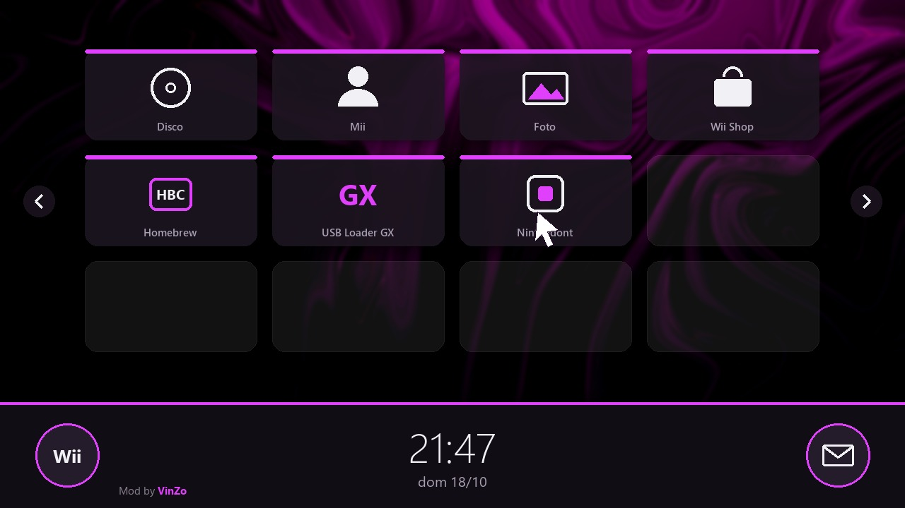

# Wii VinZo Theme — Material Dark

Tema per il **menu di sistema Wii 4.3E** in stile Material Dark con accento viola,
sfondo personalizzato e firma "Mod by VinZo". Generato da script Python a partire dal
menu originale della console, senza ThemeMii.



## Cosa cambia

| Parte | Archivio | Modifica |
|---|---|---|
| Sfondo dietro i canali + firma | `chanSel.ash` | `my_TVSheet_b` → wallpaper 512x288 RGB565, UV dei pannelli `Picture_00-04`/`BaseMask0-4` portate a 0..1 |
| Barra inferiore | `chanSel.ash` | materiali `board*`, `Picture_05-09` scuri, `Line*`/`Edge*` viola |
| Orologio | `chanSel.ash` | cifre ridisegnate (Segoe UI Light) in I4 48x48, materiali bianchi |
| Slot vuoti | `chanSel.ash` | materiale `Ch0` scuro |
| Pulsanti Wii/posta/calendario/+/−/frecce | `cmnBtn.ash` | texture ridisegnate RGB5A3 |
| Sfondo bacheca messaggi | `board.ash` | `my_BackPic_a` → wallpaper 544x408 CMPR |
| Cursore P1 | `cursor.ash` | colore viola |
| Schermata del canale | `chanTtl.ash` | barra e pulsanti scuri, testo bianco, evidenziazione viola |

Tutti gli altri archivi (impostazioni, dialoghi, menu SD…) restano originali.

## Ricostruire il tema

Requisiti: Windows, Python 3, `ASH.exe` di ThemeMii (in `Documents\Wii\ThemeMii`),
il file base `base\0000009a-v514.app` (scaricato dalla console con csm-installer).

```powershell
.\build.ps1
```

Il risultato è in `build\vinzo_material_dark_4.3E.csm`. Copialo in `themes\` sulla SD/USB e
installalo con **csm-installer**.

> `base/` e i `.csm` contengono dati Nintendo: sono esclusi dal repository (`.gitignore`).

## Sicurezza

- Installare solo con **Priiloader** presente (RESET all'accensione → Homebrew Channel).
- Il backup NAND è in `Documents\Wii\Wii_NAND_Backup_2026-10-18`.
- Per tornare indietro: csm-installer → `original_backup` o `azurenight.csm`.

## Struttura

- `tools/` — librerie (U8, TPL, BRLYT, BRLAN, LZ77) e script di build/analisi
- `assets/` — wallpaper sorgente
- `preview/` — anteprime
- `docs/CONVERSAZIONE.md` — riassunto di come è nato il progetto e delle decisioni
- `.claude/skills/wii-theme-vinzo/` — skill per Claude Code per modifiche future
